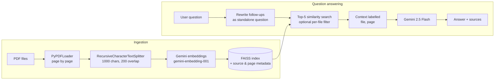

# 📚 Chat with your PDFs

A Retrieval-Augmented Generation (RAG) chatbot that answers questions about your own PDF documents. Upload one or many PDFs, ask questions in plain language, and get answers with **file and page citations** so you can check every claim.


## ✨ Features

- **Multi-PDF knowledge base**: upload several PDFs from the sidebar; each is added to one shared index.
- **Source citations**: every answer shows which file and page it came from, with the retrieved passages in an expandable panel.
- **Follow-up questions**: a question-rewriting step turns "what about the second one?" into a standalone query before searching.
- **"Search in" filter**: limit a question to one document or any subset of your PDFs.
- **Grounded answers**: the model is told to answer only from the retrieved context and to say *"I couldn't find that in the documents"* when the answer isn't there.
- **Duplicate detection**: re-uploading an already indexed file is skipped, so you never pay for the same embeddings twice.
- **Free-tier friendly**: embeddings are created in small batches with automatic retry when Gemini's rate limit is hit.
- **Two interfaces**: a Streamlit web app and a terminal chatbot.

## 🧠 How it works



1. **Ingest:** each PDF is split into overlapping chunks. Every chunk keeps its filename and page number as metadata, which is what makes citations possible.
2. **Embed and store:** chunks are embedded with `gemini-embedding-001` and saved in a local FAISS index.
3. **Retrieve:** the question (rewritten into a standalone one if there is chat history) is embedded and matched against the index, returning the 5 closest chunks.
4. **Generate:** the chunks are passed to Gemini 2.5 Flash with instructions to answer only from them and cite `(file.pdf, p. N)`.

## 🛠️ Tech stack

| Technology | Purpose |
|---|---|
| Python 3.10+ | Core language |
| LangChain (LCEL) | Prompting and chain composition |
| Google Gemini `gemini-2.5-flash` | Answer generation and question rewriting |
| Gemini Embeddings `gemini-embedding-001` | Text to vector conversion |
| FAISS (CPU) | Local vector database |
| Streamlit | Web UI |
| PyPDF | PDF text extraction |
| python-dotenv | API key management |

## 📁 Project structure

```
rag-chatbot/
├── app.py              # Streamlit web UI (upload, search filter, chat, sources)
├── chat.py             # RAG logic: retrieval, question rewriting, answer + citations; CLI chat
├── ingest.py           # PDF loading, chunking, batched embedding, FAISS index management
├── main.py             # CLI entry point: indexes any new PDFs in data/, then starts the chat
├── requirements.txt    # Pinned dependencies
├── data/               # Your PDFs (git-ignored)
├── faiss_index/        # Generated vector index (git-ignored)
├── .env                # Your API key (git-ignored)
└── .gitignore
```

## 🚀 Getting started

### 1. Clone and install

```bash
git clone https://github.com/shoebbagwan/rag-chatbot.git
cd rag-chatbot

python -m venv venv
# Windows
venv\Scripts\activate
# macOS / Linux
source venv/bin/activate

pip install -r requirements.txt
```

### 2. Add your API key

Get a free key from [Google AI Studio](https://aistudio.google.com/) and create a `.env` file in the project root:

```
GOOGLE_API_KEY=your_key_here
```

### 3. Run it

**Web app:**

```bash
streamlit run app.py
```

Open the sidebar, upload one or more PDFs, click **Add to knowledge base**, and start asking questions.

**Terminal chatbot:**

```bash
# Put PDFs in the data/ folder, then:
python main.py
```

`main.py` indexes any PDFs in `data/` that are not indexed yet and then starts the chat. You can also index specific files directly:

```bash
python ingest.py "data/book1.pdf" "data/book2.pdf"
```

> ⏱️ **First run note:** on Gemini's free tier, embeddings are created in small batches with short pauses to stay under the rate limit. A full-length book can take a few minutes to index. This only happens once per file.

## 💡 Usage tips

- Use **Search in** in the sidebar to restrict answers to specific documents.
- Open the **📖 Sources** panel under an answer to see the exact passages and pages used.
- Ask follow-ups naturally ("give me an example of that"); the app uses the recent chat history.
- Click **Clear chat** to start a fresh conversation.

## 📝 Design notes

- **Page numbers are PDF page numbers**, counted from the first physical page of the file (what a PDF viewer shows), not the numbers printed on the book's pages. Books with a cover and front matter will differ by a fixed offset.
- **Chunking:** 1000 characters with 200 overlap, so ideas that span a boundary stay retrievable.
- **Rate limits:** embedding batches of 10 with a 3-second pause, and up to 5 retries with a 30-second wait on `RESOURCE_EXHAUSTED`. Real errors are raised instead of silently skipping a batch.
- **Index loading:** FAISS indexes are loaded with `allow_dangerous_deserialization=True`. This is safe here because the index is built locally from your own files, but never load an index file from a source you don't trust.

## ⚠️ Limitations

- **Scanned PDFs** without a text layer can't be read (there is no OCR). They are skipped with a warning.
- The index is stored on **local disk**. On hosting platforms with an ephemeral filesystem, uploaded documents will not persist across restarts.
- Retrieval is similarity-based only; table-of-contents and other front-matter pages can occasionally be retrieved alongside real content.
- Answer quality depends on the retrieved passages, and a formal retrieval evaluation has not been published yet.

## 🗺️ Roadmap

- [ ] Retrieval evaluation script (hit@k on a labelled question set)
- [ ] Live demo deployment
- [ ] Hybrid search (keyword + embeddings) and reranking
- [ ] Expose retrieval as an MCP server
- [ ] Docker and CI

## 🔒 A note on documents

`data/` and `faiss_index/` are git-ignored on purpose. Don't commit copyrighted PDFs or indexes built from them to a public repository.

## 👤 Author

Built by **Shoeb** ([@shoebbagwan](https://github.com/shoebbagwan)).

Contributions, issues and suggestions are welcome.
